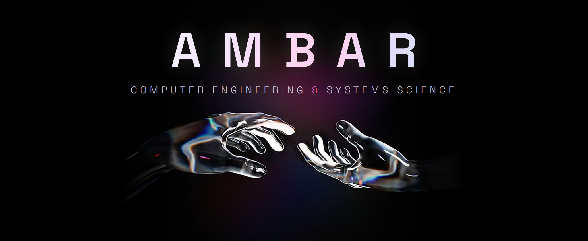

<div align="center">




[](https://mioport-blond.vercel.app)
[](https://www.linkedin.com/in/dalmaag345/)
[](mailto:agostina4461@gmail.com)

</div>

---

## About Me

Advanced student of **Computer Engineering** and **Systems Science** at **Universidad Nacional de Jujuy**, currently finishing my last courses. I completed a **Data Analysis diploma** and I plan to specialize in **functional analysis** and **software architecture**.

### What Drives Me

I like finding fast and simple solutions without losing sight of the trade-offs of each path. Lately I've joined the **Web3** developer community, taking part in hackathons to keep learning by building with other people.

---

## Featured Projects

<table>
<tr>
<td width="50%" valign="top">

### Tutoring System FI
**Management platform for the Faculty of Engineering tutoring team**

A web system that digitizes the tutoring team's logging of hours, events and inquiries.

**Impact:**
- Replaces manual tracking
- Enables auditing of every record
- Provides team metrics

**Live:** [sistema-de-tutorias.vercel.app](https://sistema-de-tutorias.vercel.app)

</td>
<td width="50%" valign="top">

### Personal Portfolio
**Static site with a Dark Tech look**

My portfolio, handcrafted without frameworks, with project and skills carousels.

**Highlights:**
- Plain HTML, CSS and JavaScript
- Responsive and accessible design
- Continuous deployment on Vercel

**Live:** [mioport-blond.vercel.app](https://mioport-blond.vercel.app) · [repo](https://github.com/ambar345/mioport)

</td>
</tr>
</table>

---

## Tech Stack

<div align="center">

### Languages
<table>
<tr>
<td align="center" width="88">

<br><sub>Python</sub>
</td>
<td align="center" width="88">

<br><sub>JavaScript</sub>
</td>
<td align="center" width="88">

<br><sub>HTML5</sub>
</td>
<td align="center" width="88">

<br><sub>CSS3</sub>
</td>
<td align="center" width="88">
<b>:-</b><br><sub>Prolog</sub>
</td>
<td align="center" width="88">
<b>λ</b><br><sub>Lisp</sub>
</td>
</tr>
</table>

### Databases & Tools
<table>
<tr>
<td align="center" width="88">

<br><sub>PostgreSQL</sub>
</td>
<td align="center" width="88">

<br><sub>Supabase</sub>
</td>
<td align="center" width="88">

<br><sub>Git</sub>
</td>
<td align="center" width="88">

<br><sub>GitHub</sub>
</td>
<td align="center" width="88">

<br><sub>Vercel</sub>
</td>
</tr>
</table>

</div>

---

## GitHub Analytics

<div align="center">


</div>

<div align="center">

</div>

---

## Current Focus & Interests

```javascript
const ambar = {
    currentStatus: "Final courses of Computer Engineering & Systems Science",
    education: ["Data Analysis Diploma"],
    learning: ["Information Retrieval", "Text Classification", "Data Mining"],
    interests: ["Functional Analysis", "Software Architecture", "Data applied to fashion"],
    community: ["Web3", "Hackathons"]
};
```

---

## Beyond Code

<div align="center">

<table>
<tr>
<td align="center" width="25%">
<br>
<b>Running</b><br>
<sub>Clearing my head, one km at a time</sub>
</td>
<td align="center" width="25%">
<br>
<b>Basketball</b><br>
<sub>Shooting hoops</sub>
</td>
<td align="center" width="25%">
<br>
<b>Sunset Photography</b><br>
<sub>Chasing golden hour</sub>
</td>
<td align="center" width="25%">
<br>
<b>Hydration</b><br>
<sub>Drinking lots of water</sub>
</td>
</tr>
</table>

</div>

---

## Let's Connect

<div align="center">

Have a project in mind or an idea to talk about? Reach out.

[](https://www.linkedin.com/in/dalmaag345/)
[](mailto:agostina4461@gmail.com)

<br>


</div>

<div align="center">

</div>
